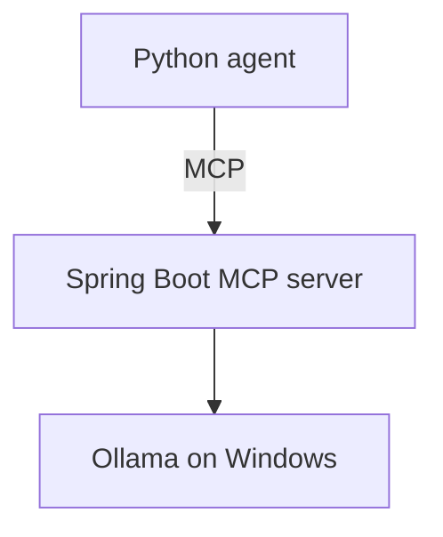

# Content scripts

Helper scripts for writing articles (BLOG_AUTOMATION.md §6, §8, §10). The `scripts/` folder is
excluded from the Jekyll build, so nothing here is published.

Setup, once: `python -m pip install --user -r scripts/requirements.txt` (PyYAML, Pillow).
The featured-image script also needs Microsoft Edge or Google Chrome (set `BROWSER_PATH` if it
isn't found automatically).

## next_article.py: what to write next

```bash
python scripts/next_article.py                  # next "ready" article, or what is still being built
python scripts/next_article.py --status         # the whole calendar
python scripts/next_article.py --mark 1 building
python scripts/next_article.py --mark 1 ready   # the author does this when the lab folder is complete
python scripts/next_article.py --mark 1 drafted --post _posts/2026-12-01-local-ai-windows.md
python scripts/next_article.py --mark 1 published
```

The calendar lives in `_data/content_calendar.yml`. Only `ready` entries are proposed, calendar
entries before backlog entries, at most one backlog article per 7 days and at most 3 published
articles per 7 days. Exit codes: 0 ready, 1 nothing ready, 2 paused by the cadence limits.

## featured_image.py: header and share image

```bash
python scripts/featured_image.py --post _posts/2026-12-01-local-ai-windows.md --write
python scripts/featured_image.py --title "Local AI on Windows" --slug local-ai-windows --kicker "local ai"
```

Renders `scripts/templates/featured.html` (Kit, title, kicker, codersite.dev) to a 1200x630 JPG in
`assets/images/posts/<slug>.jpg`. The kicker defaults to the post's first tag, or its pillar.
`--write` sets `image:` in the front matter; `--force` overwrites an existing image.

## Mermaid diagrams in posts

Add `mermaid: true` to the front matter and write diagrams as fenced code blocks:

````markdown

````

The self-hosted library (`assets/js/lib/mermaid-11.17.2.min.js`) loads only on those posts.
Prefer `flowchart TD` (top to bottom): wide left-to-right diagrams become small on phones.
