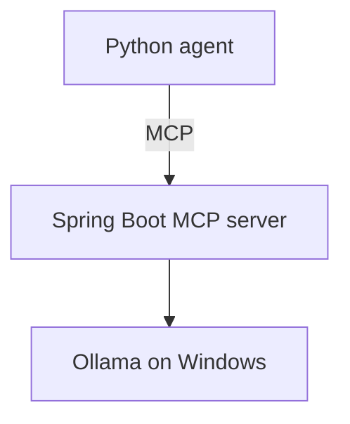

# Content scripts

Helper scripts for writing articles (BLOG_AUTOMATION.md §6, §8, §10). The `scripts/` folder is
excluded from the Jekyll build, so nothing here is published.

Setup, once: `python -m pip install --user -r scripts/requirements.txt` (PyYAML, Pillow).
The featured-image script also needs Microsoft Edge or Google Chrome (set `BROWSER_PATH` if it
isn't found automatically).

## next_article.py: what to write next

```bash
python scripts/next_article.py                  # next "ready" article, or what is still being built
python scripts/next_article.py --status         # the whole calendar
python scripts/next_article.py --mark 1 building
python scripts/next_article.py --mark 1 ready   # the author does this when the lab folder is complete
python scripts/next_article.py --mark 1 drafted --post _posts/2026-12-01-local-ai-windows.md
python scripts/next_article.py --mark 1 published
```

The calendar lives in `_data/content_calendar.yml`. Only `ready` entries are proposed, calendar
entries before backlog entries, at most one backlog article per 7 days and at most 3 published
articles per 7 days. Exit codes: 0 ready, 1 nothing ready, 2 paused by the cadence limits.

## featured_image.py: header and share image

```bash
python scripts/featured_image.py --post _posts/2026-12-01-local-ai-windows.md --write
python scripts/featured_image.py --post _posts/2023-02-02-rate-limit.md --motif code --force --write
python scripts/featured_image.py --title "Local AI on Windows" --slug local-ai-windows --pillar "Self-Hosting & Local AI" --tags "wsl2,docker,ollama"
python scripts/featured_image.py --list-motifs
```

Renders a 1200x630 JPG to `assets/images/posts/<slug>.jpg` (about 65-95 KB).
`--write` sets `image:` in the front matter; `--force` overwrites an existing image;
`--out FILE` saves a preview elsewhere without touching `assets/`.

Style `v2` (default, `scripts/templates/featured-v2.html`):
- colour theme per pillar (Java green, Algorithms indigo, Design navy, AI violet/cyan, Self-hosting charcoal);
- large title, pillar label, up to 3 tags, the codersite logo;
- a drawing of the topic, picked from the title first, then the tags, then the description
  (rate limiting, security, containers, AI agents, tree, graph, Big O, hash map, performance,
  distributed, UML, REST API, career). Several drawings use details from the post itself:
  its endpoints and status codes, its interface and classes, its section headings, its TLS
  version or auth event, its rate limit;
- algorithm posts, and posts without a matching drawing, show a code window with the post's
  first substantial code example.
Overrides: `--motif`, `--theme`, `--tags "a,b"`, `--pillar`.

Headline: the image shows a short headline, not the full title (the page and the social card
already show the title). It is `image_title:` from the front matter if set, otherwise the part
of the title before the first colon ("Rate Limiting in Spring Boot with Bucket4j"), otherwise the
title without a trailing note in brackets. `--full-title` shows the whole title.

Style `classic` (`--style classic`, `scripts/templates/featured.html`): Kit the fox and the title.

## Mermaid diagrams in posts

Add `mermaid: true` to the front matter and write diagrams as fenced code blocks:

````markdown

````

The self-hosted library (`assets/js/lib/mermaid-11.17.2.min.js`) loads only on those posts.
Prefer `flowchart TD` (top to bottom): wide left-to-right diagrams become small on phones.
